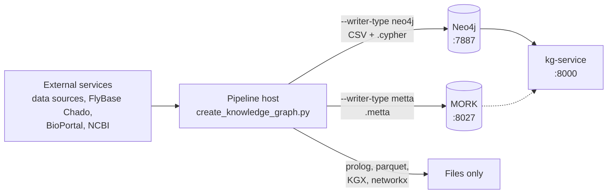

# Deployment Guide

This is the single guide for deploying BioCypher-KG and everything it depends on: the pipeline host, Neo4j, the MORK server, kg-service, the optional MeTTa consumers, and the external services the adapters connect to. Every command, port and default here was checked against the code on `main`; where a path is currently broken, this guide says so and links to [Known issues](#known-issues).

**Related docs:**
- [configuration.md](configuration.md) — pipeline config files and CLI flags
- [troubleshooting.md](troubleshooting.md) — symptoms and fixes
- [README.md](https://github.com/rejuve-bio/biocypher-kg/blob/main/README.md) — building the KG (`make run`, `make download`)

---

## At a glance

| Component | What it is | How it runs | Host port(s) | Status on `main` |
|---|---|---|---|---|
| [Pipeline host](#pipeline-host) | `create_knowledge_graph.py`, which builds the KG files | `uv` on the host (`make run*`) | — | Works |
| [Neo4j](#neo4j) | Graph database for the `neo4j` writer's output | [`docker/docker-compose.neo4j.yml`](https://github.com/rejuve-bio/biocypher-kg/blob/main/docker/docker-compose.neo4j.yml) via `make neo4j-*` | `7674` HTTP, `7887` Bolt | Works |
| [MORK](#mork) | MeTTa graph server for the `metta` writer's output | [`biocypher-mork/`](https://github.com/rejuve-bio/biocypher-kg/tree/main/biocypher-mork) Docker image | `8027` | Works, with setup caveats |
| [kg-service](#kg-service) | FastAPI service for graph metadata and version history | `uvicorn` on the host | `8000` | **Does not start** ([Known issues](#known-issues)) |
| [MeTTa consumers](#optional-metta-consumers) | Hyperon in-process space, DAS | Host scripts | — | Optional; not project dependencies |
| [External services](#external-services) | Data-source hosts, FlyBase Chado, BioPortal, NCBI | Outbound network | — | — |



Neo4j publishes its ports on `127.0.0.1` only. MORK publishes `8027` on all interfaces, so firewall it on shared hosts.

---

## Prerequisites

| Requirement | Needed for | Notes |
|---|---|---|
| Docker Engine with Compose v2 (`docker compose`) | Neo4j, MORK | |
| Python 3.10–3.12 | Pipeline, loaders, kg-service | `pyproject.toml` requires `>=3.10,<3.13`; `.python-version` pins 3.10 |
| [uv](https://github.com/astral-sh/uv) | Pipeline | `make setup` installs it if missing |
| `libpq-dev` (provides `pg_config`) | `uv sync` | `psycopg2` is built from source, not installed as `psycopg2-binary` |
| Outbound HTTPS, and TCP `5432` to `chado.flybase.org` | Full builds | See [External services](#external-services) |

Hardware sizing for full builds is not documented yet. The largest single item is the dbSNP cache for full human builds (see [dbSNP cache](#dbsnp-cache-human-only)).

---

## Pipeline host

```bash
git clone https://github.com/rejuve-bio/biocypher-kg.git
cd biocypher-kg
make setup            # installs uv if needed, then runs uv sync
cp .env.example .env  # optional, see BIOPORTAL_API_KEY below
```

Then build with `make run` (interactive), `make run-sample` or `make run-direct`. The [README](https://github.com/rejuve-bio/biocypher-kg/blob/main/README.md) is the full reference for running builds and downloading data.

- **`uv.lock` is out of date** with `pyproject.toml`, so `uv sync --locked` fails. Plain `uv sync` (what `make setup` runs) re-resolves and rewrites `uv.lock`.
- **`.env`** holds one setting, `BIOPORTAL_API_KEY`, and it is optional. The Disease Ontology adapter downloads from OBOLibrary and only falls back to BioPortal when that download fails and a key is set.

### Choose a writer for your backend

| `--writer-type` | Output | Consumed by |
|---|---|---|
| `neo4j` | CSV files plus `nodes_*.cypher` / `edges_*.cypher` load scripts | [Neo4j](#neo4j) |
| `metta` | `*.metta` files plus `type_defs.metta` | [MORK](#mork), [Hyperon or DAS](#optional-metta-consumers) |
| `prolog`, `parquet`, `KGX`, `networkx` | Files | No service; use the files directly |

### dbSNP cache (human only)

Full `hsa` builds need a prebuilt dbSNP cache. Sample builds use the bundled `aux_files/hsa/sample_dbsnp`, and other species don't use dbSNP at all. Build the cache with `scripts/update_dbsnp.py`, then pass `--dbsnp-cache-root` or set `dbsnp_cache_root` in `config/species_config.yaml`. See [README § dbSNP Cache](https://github.com/rejuve-bio/biocypher-kg/blob/main/README.md#-dbsnp-cache) and the [processors README](https://github.com/rejuve-bio/biocypher-kg/blob/main/biocypher_metta/processors/README.md) for build options.

---

## Neo4j

The supported setup is the parameterised compose file [`docker/docker-compose.neo4j.yml`](https://github.com/rejuve-bio/biocypher-kg/blob/main/docker/docker-compose.neo4j.yml), driven by `make neo4j-*` targets. It runs `neo4j:5.21` (Community edition) with APOC, mounts your build output read-only at `/import`, and keeps data in named volumes.

> Don't use the `build`, `import` and `deploy` services in the root `docker-compose.yml`. They are left over from the BioCypher project template and no longer work (see [Known issues](#known-issues)).

### 1. Configure `docker/neo4j.env`

```bash
cp docker/neo4j.env.example docker/neo4j.env   # gitignored
```

| Variable | Example value | Read by | Notes |
|---|---|---|---|
| `NEO4J_IMAGE` | `neo4j:5.21` | compose | |
| `NEO4J_HTTP_PORT` | `7674` | compose | Browser at `http://localhost:7674/browser/` |
| `NEO4J_BOLT_PORT` | `7887` | compose | |
| `NEO4J_AUTH` | `neo4j/your_password_here` | compose | Applied only when the data volume is first created. After changing it, run `make neo4j-reset` |
| `NEO4J_OUTPUT_DIR` | *(required)* | compose, both loaders | Host directory mounted read-only at `/import`. For one species, use that build's `--output-dir`. For several species in one instance, use the parent directory (see [step 4](#4-several-species)) |
| `NEO4J_ARCHIVE_DIR` | — | `make neo4j-load` | Where versioned loads archive each changed dataset |
| `NEO4J_PAGECACHE` / `NEO4J_HEAP_INIT` / `NEO4J_HEAP_MAX` | `4G` / `2G` / `4G` | compose | See [Memory](#memory) |
| `NEO4J_URI` | `bolt://localhost:7887` | both loaders | Must use the `NEO4J_BOLT_PORT` port |
| `NEO4J_USERNAME` | `neo4j` | both loaders | |
| `NEO4J_PASSWORD` | — | both loaders | Must match the password in `NEO4J_AUTH` |
| `NEO4J_IMPORT_BATCH_SIZE` | `50000` | `make neo4j-load` | APOC batch size |
| `CSV_BASE_PATH` | *(unset)* | `make neo4j-load-direct` | Only for a non-Docker Neo4j whose import directory isn't `NEO4J_OUTPUT_DIR` |
| `NEO4J_CONTAINER` | `neo4j_bio_atomspace` | nothing | Ignored. The container is always named `biocypher_neo4j-neo4j-1` |

### 2. Start and manage the container

| Command | Effect |
|---|---|
| `make neo4j-up` | Start the container, or recreate it if its configuration changed. Data is kept |
| `make neo4j-status` | Show container status |
| `make neo4j-logs` | Follow container logs |
| `make neo4j-down` | Stop and remove the container. The data volumes are kept |
| `make neo4j-reset` | **Delete the data volumes**, then start fresh so `NEO4J_AUTH` and other settings are applied again |

To use a different env file, pass `NEO4J_ENV_FILE=docker/my.env` to any target. All targets use the compose project `biocypher_neo4j` (override with `NEO4J_PROJECT_NAME`), which is why the container is named `biocypher_neo4j-neo4j-1`.

### 3. Load data

Build with `--writer-type neo4j` first, then load with one of two targets:

| | `make neo4j-load-direct` | `make neo4j-load` |
|---|---|---|
| Script | [`scripts/neo4j_loader.py`](https://github.com/rejuve-bio/biocypher-kg/blob/main/scripts/neo4j_loader.py) | [`kg-service/neo4j_loader.py`](https://github.com/rejuve-bio/biocypher-kg/blob/main/kg-service/neo4j_loader.py) |
| Loads | Every directory under `NEO4J_OUTPUT_DIR` that contains `.cypher` files: nodes first, then edges | Only the top-level dataset folders whose CSV files changed since the last load (MD5 hash) |
| Before loading | Nothing. Existing data is not removed | Archives each changed folder to `NEO4J_ARCHIVE_DIR/neo4j/<dataset>/<vN>/`, then deletes that dataset's old nodes and edges |
| Version metadata | None | Writes `KGVersion`, `DatasetVersion`, `DatasetHash` and `DatasetMapping` nodes |
| Requires | `NEO4J_OUTPUT_DIR`, `NEO4J_URI`, `NEO4J_PASSWORD` (prompts if unset) | The same, plus `NEO4J_ARCHIVE_DIR` |

Use `neo4j-load-direct` for a clean load into an empty database (fresh volumes or after `make neo4j-reset`). Use `neo4j-load` to reload an instance after rebuilding some datasets.

Both loaders read `docker/neo4j.env` via `--env-file`; flags given on the command line override it.

- `scripts/neo4j_loader.py`: `--env-file`, `--output-dir`, `--uri`, `--username`, `--password`, `--csv-base-path`. Without an env file, `--uri` defaults to `bolt://localhost:7687`, Neo4j's standard port, not the compose port.
- `kg-service/neo4j_loader.py`: `--env-file`, `--output-dir`, `--archive-dir`, `--uri`, `--username`, `--password`, `--build-id` (default `build-<UTC timestamp>`), `--import-batch-size`, `--import-dir`. `--import-dir` is for a non-Docker Neo4j only and has no env-file key.

### 4. Several species

A Neo4j instance holds whatever you load into it. You can run it in one of two ways:

- **All species in one instance.** Build with `--species all` and set `NEO4J_OUTPUT_DIR` to that run's parent output directory. Each species' `.cypher` files reference `file:///<species>/...` relative to it. Output built before this layout was introduced can be rewritten once with [`scripts/fix_cypher_import_paths.py`](https://github.com/rejuve-bio/biocypher-kg/blob/main/scripts/fix_cypher_import_paths.py).
- **One species at a time (sample builds).** `scripts/switch_species.sh <hsa|dmel|mmu|rno|cel>` points `docker/neo4j.env` at `output_<species>_sample/`, runs `make neo4j-reset` and loads with `scripts/neo4j_loader.py`. This wipes the current graph.

### 5. Without make

```bash
docker compose -p biocypher_neo4j --env-file docker/neo4j.env \
  -f docker/docker-compose.neo4j.yml up -d
```

Keep `-p biocypher_neo4j`. Without it, compose uses a different project name and creates new, empty volumes. (The usage comment at the top of the compose file leaves it out.)

To run the container without compose, mount the output at Neo4j's default import directory and enable APOC file access:

```bash
docker run -d --name neo4j_bio \
  -p 127.0.0.1:7674:7474 -p 127.0.0.1:7887:7687 \
  -v /path/to/output:/var/lib/neo4j/import:ro \
  -e NEO4J_AUTH=neo4j/<password> \
  -e NEO4J_PLUGINS='["apoc"]' \
  -e NEO4J_apoc_import_file_enabled=true \
  -e NEO4J_apoc_import_file_use__neo4j__config=false \
  -e NEO4J_dbms_security_procedures_unrestricted='apoc.*' \
  neo4j:5.21
```

Without the `/var/lib/neo4j/import` mount, `LOAD CSV` fails with `NoSuchFileException`.

### Memory

The defaults (`4G` page cache, `2G`/`4G` heap) suit sample builds. For full builds, raise them in `docker/neo4j.env` and run `make neo4j-up`; compose recreates the container and keeps the data. To get a starting point sized to the host, run:

```bash
docker exec biocypher_neo4j-neo4j-1 neo4j-admin server memory-recommendation
```

### Verify the database

```bash
make neo4j-status
docker exec biocypher_neo4j-neo4j-1 cypher-shell -u neo4j -p '<password>' \
  'MATCH (n) RETURN count(n) AS nodes;'
```

In the browser, open `http://localhost:7674/browser/` and connect to `bolt://localhost:7887`. The compose file defines no health check, so `make neo4j-status` shows "running" rather than "healthy". To tell when Neo4j is ready, wait for `Started.` in `make neo4j-logs`.

---

## MORK

MORK serves the `metta` writer's output over HTTP on port `8027`. The image is built from [`biocypher-mork/Dockerfile`](https://github.com/rejuve-bio/biocypher-kg/blob/main/biocypher-mork/Dockerfile). It compiles [PathMap](https://github.com/Adam-Vandervorst/PathMap) and the `server` branch of [Abdu1964/MORK](https://github.com/Abdu1964/MORK) on `rustlang/rust:nightly`. Neither repository is pinned to a commit, so images built on different days can differ, and the first build is slow because both are compiled in release mode.

### 1. Run the server

Two compose files can start the image, and both name the container `mork-biocypher`, so run only one of them. Use the one in `biocypher-mork/`: its defaults match the loader's and the persistence layer's.

**Standalone (recommended).** Run from `biocypher-mork/`:

```bash
cd biocypher-mork
cat > .env <<'EOF'
# Directory holding the .metta build output (absolute, or relative to biocypher-mork/)
MORK_DATA_DIR=/path/to/output
# Host port; the container always listens on 8027
HOST_PORT=8027
# Seconds between snapshots
SNAPSHOT_INTERVAL_SECONDS=300
EOF
sudo chown -R 1000:1000 mork_persist   # the container runs as UID 1000 and must write here
docker compose up -d --build
```

- **`.env` is required.** The compose file declares `env_file: .env` and refuses to start without it. The repo has no template for it, and it is gitignored.
- **`mork_persist/` must be writable by UID 1000.** If it isn't, the container exits at start with `ERROR: /app/persist is not writable`. Skip the `chown` if your user ID (`id -u`) is already 1000.

**From the repo root.** The root `docker-compose.yml` defines the same server as service `mork`:

```bash
mkdir -p mork_persist && sudo chown 1000:1000 mork_persist
MORK_DATA_DIR=./output MORK_HOST_PORT=8027 docker compose up -d mork
```

This variant differs from the standalone one in three ways:
- The host-port variable is `MORK_HOST_PORT`, not `HOST_PORT`.
- Data defaults to `./output_human`.
- Persistence lives in the repo-root `mork_persist/`, which doesn't exist until you create it. When loading data, export `SNAPSHOT_DIR=$PWD/mork_persist`.

| Variable | Read by | Default | Purpose |
|---|---|---|---|
| `MORK_DATA_DIR` | both compose files | `./data` (in `biocypher-mork/`), `./output_human` (root) | Host directory mounted at `/app/data` |
| `HOST_PORT` | `biocypher-mork/docker-compose.yml`, `data_loader.py` | `8027` | Host port |
| `MORK_HOST_PORT` | root `docker-compose.yml` | `8027` | Host port |
| `SNAPSHOT_INTERVAL_SECONDS` | both compose files | `300` | Seconds between snapshots |
| `SNAPSHOT_DIR` | `data_loader.py`, `wal_client.py` (host side) | `biocypher-mork/mork_persist` | Where the host-side client appends to the WAL. Inside the container it is always `/app/persist` |
| `DATASET_PATH` | `data_loader.py` | `./data` | Directory to load |

### 2. Persistence

| File | Written by | Contents |
|---|---|---|
| `mork_persist/snapshot.paths` | The container | A full binary snapshot. Written every `SNAPSHOT_INTERVAL_SECONDS` while the server is idle, and again on shutdown. The WAL is emptied after each successful snapshot |
| `mork_persist/wal.metta` | The Python client on the host ([`wal_client.py`](https://github.com/rejuve-bio/biocypher-kg/blob/main/biocypher-mork/wal_client.py)) | Writes made since the last snapshot |

On start, the container imports the snapshot, then replays the WAL.

- **File loads are not written to the WAL.** `data_loader.py` asks the server to import files by their container path (`/app/data/...`), and its WAL client can't read that path from the host. You'll see `[WalMORK] WARNING: could not tee ...`, and the loaded data survives a restart only after the next snapshot. After a load, wait one snapshot interval, or stop the container cleanly so it snapshots on the way down.
- **Allow enough time for the final snapshot.** Compose's default stop timeout is 10 seconds, but the final snapshot waits up to 240 seconds for a large export. Stop with `docker compose stop -t 300` (or `down -t 300`) so the snapshot isn't killed part-way.

To start over with an empty graph:

```bash
docker compose down -t 300
sudo truncate -s 0 mork_persist/snapshot.paths mork_persist/wal.metta
docker compose up -d
```

### 3. Load MeTTa data

Build with `--writer-type metta`, then run [`biocypher-mork/data_loader.py`](https://github.com/rejuve-bio/biocypher-kg/blob/main/biocypher-mork/data_loader.py) from the repo root:

```bash
DATASET_PATH=/path/to/output HOST_PORT=8027 uv run python biocypher-mork/data_loader.py
```

- **Set `DATASET_PATH` to the same directory as `MORK_DATA_DIR`.** The loader sends the server each file's path under `/app/data`, and the server reads the file from its own mount.
- It loads every `.metta` and `.paths` file under that directory, recursively, into the `annotation` namespace, then prints a sample of the loaded facts.
- It doesn't clear existing data first. To reload from scratch, empty the graph as shown above.
- With the root-compose variant, also set `SNAPSHOT_DIR=$PWD/mork_persist`.

The repo has three other MORK loaders, but none of them currently works: `scripts/mork_loader.py`, `scripts/load_paths.py` and `kg-service/mork_loader.py` (see [Known issues](#known-issues)).

### 4. Verify the server

```bash
docker compose ps                      # "healthy" once the 60 s start period has passed
docker compose logs -f mork-biocypher  # service name in biocypher-mork/; it is "mork" in the root compose
curl http://localhost:8027/status/-
```

### 5. MORK CLI tools (ACT, `.paths`, REPL): currently unavailable

The repo has three scripts that work with MORK's command-line kernel instead of the server:

- [`scripts/build_act.sh`](https://github.com/rejuve-bio/biocypher-kg/blob/main/scripts/build_act.sh) `<dir>` compiles every `.metta` file in dependency order (types, then nodes, then edges) into a single memory-mapped `annotation.act`.
- [`scripts/build_paths.sh`](https://github.com/rejuve-bio/biocypher-kg/blob/main/scripts/build_paths.sh) converts each `.metta` file to binary `.paths`, skipping files it has already converted.
- [`scripts/mork_repl.py`](https://github.com/rejuve-bio/biocypher-kg/blob/main/scripts/mork_repl.py) `--format act|paths|metta` is an interactive query loop. In `paths` and `metta` modes it reloads the data for every query, so it can be used to compare load time against query time.

All three run `docker compose run --rm mork` from the repo root and call `/app/MORK/target/release/mork`. The current image doesn't build that binary (the build step is commented out in the Dockerfile), so all three fail until it's restored.

---

## kg-service

> **Status: kg-service does not start on `main`.** `backend/api/main.py` imports the route modules `meta` and `entities`, and neither exists. Open PR [#379](https://github.com/rejuve-bio/biocypher-kg/pull/379) adds `meta.py`. To run the service before a fix lands, remove `meta` and `entities` from the import on line 8 and delete their two `include_router` lines. Several endpoints have further problems; see [Known issues](#known-issues).

kg-service ("BioCypher KG Observatory") is a FastAPI app that serves graph metadata and version history. It reads from Neo4j and from the archive directory that `make neo4j-load` writes. It isn't containerized; run it on a host that can reach Neo4j.

### 1. Install

kg-service's dependencies are not in the project's `pyproject.toml`. Install them into a separate environment:

```bash
cd kg-service
uv venv                              # creates kg-service/.venv (gitignored)
uv pip install -r requirements.txt
```

### 2. Configure `kg-service/.env`

Settings are read from `.env` in the working directory, so always start the service from `kg-service/`. Every default in [`config.py`](https://github.com/rejuve-bio/biocypher-kg/blob/main/kg-service/backend/core/config.py) is either a placeholder or a path on one team server, so set all of these:

```env
NEO4J_URI=bolt://localhost:7887
NEO4J_USER=neo4j
NEO4J_PASSWORD=<same as NEO4J_PASSWORD in docker/neo4j.env>
NEO4J_DATABASE=neo4j
ARCHIVE_BASE=/path/to/biocypher-archives
VERSION_DIFF_SCRIPT=/path/to/biocypher-kg/kg-service/version_diff.py
MORK_URL=http://localhost:8027
```

Don't copy `docker/neo4j.env` into this file. Unknown keys fail validation (`extra_forbidden`), and the username key here is `NEO4J_USER`, not `NEO4J_USERNAME`.

| Setting | Code default | Set to |
|---|---|---|
| `NEO4J_URI` | `bolt://localhost:27688` | Your Bolt URI, e.g. `bolt://localhost:7887` |
| `NEO4J_USER` | `YOUR_USERNAME_HERE` | `neo4j` |
| `NEO4J_PASSWORD` | `YOUR_PASSWORD_HERE` | The Neo4j password |
| `NEO4J_DATABASE` | `YOUR_DATABASE_NAME_HERE` | `neo4j` (Community edition serves only this database) |
| `ARCHIVE_BASE` | `/mnt/hdd_1/biocypher-kg/output/human/biocypher-archives/` | The same directory as `NEO4J_ARCHIVE_DIR` |
| `VERSION_DIFF_SCRIPT` | `/home/abdum/services/biocypher-kg/version_diff.py` | Absolute path to `kg-service/version_diff.py` |
| `MORK_SUMMARY_SCRIPT` | `/home/abdum/services/biocypher-kg/get_mork_summary.py` | No working value; that script isn't in the repo |
| `MORK_URL` | `http://localhost:8432` | `http://localhost:8027` |
| `MORK_LIVE_STATS_ENABLED`, `CACHE_TTL`, `API_HOST`, `API_PORT`, `DEBUG` | — | Unused; no code reads them. The port comes from the `uvicorn` command |
| `APP_NAME`, `APP_VERSION` | `BioCypher KG Observatory`, `0.1.0` | Returned by `GET /` |

**Archive directory.** The version endpoints read `ARCHIVE_BASE/neo4j/<dataset>/<vN>/` (written by `make neo4j-load`) and `ARCHIVE_BASE/mork/`. Point `ARCHIVE_BASE` at the same directory as `NEO4J_ARCHIVE_DIR`.

### 3. Run

```bash
cd kg-service
.venv/bin/uvicorn backend.api.main:app --host 127.0.0.1 --port 8000
```

CORS allows every origin, so keep the service bound to `127.0.0.1` unless it sits behind a proxy. On startup the service schedules a `graph_info` refresh every 72 hours. If the cache file is missing, it also runs one refresh 5 seconds after start. The cache file's path is hardcoded (see [Known issues](#known-issues)).

### 4. Verify the API

```bash
curl http://localhost:8000/        # {"name": "BioCypher KG Observatory", "version": "0.1.0", "docs": "/docs"}
curl http://localhost:8000/health  # {"status": "healthy", "neo4j": "connected"}
```

Interactive API docs are served at `http://localhost:8000/docs`. The endpoint reference is in [endpoints.md](../api/endpoints.md).

### Web Console (pending #379)

Open PR [#379](https://github.com/rejuve-bio/biocypher-kg/pull/379) adds a web console that configures and runs builds and loads them into Neo4j and MORK. It is started with `docker/up.sh` and configured through `docker/console.env.example`. The PR also changes the compose files described above. Whichever of #379 and this guide merges second should document the console here and re-check the Neo4j and MORK sections against the new compose files.

---

## Optional MeTTa consumers

Neither of these is a project dependency; install what you need yourself.

**Hyperon (in-process).** [`scripts/metta_space_import.py`](https://github.com/rejuve-bio/biocypher-kg/blob/main/scripts/metta_space_import.py) loads a build's `.metta` files into an in-memory Hyperon space, runs two hard-coded human example queries, and logs load time and memory use. It's a benchmark rather than a service: the space exists only while the script runs.

```bash
uv run --with hyperon python scripts/metta_space_import.py \
  --input-dir ./output --type-def-path ./output/type_defs.metta --log hyperon_import.log
```

**DAS (Distributed AtomSpace).** [`scripts/das_metta_loader.py`](https://github.com/rejuve-bio/biocypher-kg/blob/main/scripts/das_metta_loader.py) `<dir>` runs `das-cli metta load` on every `.metta` file under `<dir>`. Before running it, install `das-cli`, then start and check a DAS server with `das-cli server start` and `das-cli server ping`. See the [das-cli README](https://github.com/singnet/das-toolbox/blob/master/das-cli/README.md).

---

## External services

| Service | Used by | Access | Notes |
|---|---|---|---|
| Data-source hosts (EBI, NCBI, UniProt, …) | `make download` | HTTPS | URLs are in `config/<species>/<species>_data_source_config.yaml` |
| FlyBase Chado PostgreSQL, `chado.flybase.org:5432` | dmel adapters (allele, genotype–phenotype, RNA-Seq library, expression value) and `reactome_edges_adapter` | Outbound TCP `5432`; public read-only account (credentials are in the adapters) | A firewall that allows only HTTPS breaks these adapters |
| BioPortal API | Disease Ontology adapter, as a fallback | HTTPS; `BIOPORTAL_API_KEY` | Optional |
| NCBI dbSNP | `scripts/update_dbsnp.py` | HTTPS | Full human builds only |
| Ontology hosts (OBOLibrary and others) | Ontology adapters | HTTPS | |

---

## Port reference

| Host port | Service | Bound to | Set by |
|---|---|---|---|
| `7674` | Neo4j HTTP and Browser | `127.0.0.1` | `NEO4J_HTTP_PORT` |
| `7887` | Neo4j Bolt | `127.0.0.1` | `NEO4J_BOLT_PORT` |
| `8027` | MORK HTTP | all interfaces | `HOST_PORT` (`biocypher-mork/`) or `MORK_HOST_PORT` (root compose) |
| `8000` | kg-service | the `uvicorn --host` value | `uvicorn --port` |
| `5432` (outbound) | FlyBase Chado | — | — |

Other port numbers in the code are leftover defaults, not services you need to run:
- `7687`: the `--uri` default in `scripts/neo4j_loader.py`
- `27688`: kg-service `NEO4J_URI` and `version_manager.py`
- `8432`: kg-service `MORK_URL`, `kg-service/mork_loader.py` and `test_mork_stats.py`
- `7474`/`7687`: the legacy root-compose `deploy` service

---

## Known issues

These are code issues. This guide documents current behaviour; fixes belong in separate PRs.

### kg-service issues

| Issue | Effect | Workaround | Where |
|---|---|---|---|
| Imports the route modules `meta` and `entities`, which don't exist | Service doesn't start | Remove them from the import and the `include_router` calls. #379 adds `meta.py` | [`main.py:8`](https://github.com/rejuve-bio/biocypher-kg/blob/main/kg-service/backend/api/main.py#L8), `:78-79` |
| Dependencies aren't in `pyproject.toml` | `uv sync` doesn't install FastAPI and the other service dependencies | Use a separate venv ([Install](#1-install)) | `kg-service/requirements.txt` |
| `MORK_SUMMARY_SCRIPT` defaults to `get_mork_summary.py`, which isn't in the repo | `/api/databases/mork/summary` fails | None | `backend/core/config.py:12` |
| The MORK client imports a Python package `mork`, which isn't installed | MORK is always reported offline | None | `backend/core/mork_client.py:22` |
| The `graph_info` cache path is hardcoded to `/mnt/hdd_1/abdu_md/...` | Cache refresh fails on other hosts | Edit the path | `backend/core/graph_info_cache.py:11` |
| The `databases` router is never registered | Its endpoints return 404 | None | `backend/api/main.py` |
| `version_diff.py` parses CSVs as comma-delimited, but the writer uses `\|` | Version comparisons are unreliable | None | `kg-service/version_diff.py`, `biocypher_metta/neo4j_csv_writer.py:17` |
| Defaults point at ports `27688` (Neo4j) and `8432` (MORK) | Can't reach either service with the defaults | Set `NEO4J_URI` and `MORK_URL` | `backend/core/config.py:6,13` |

### MORK issues

| Issue | Effect | Workaround | Where |
|---|---|---|---|
| `scripts/mork_client.py` reuses quotes inside an f-string, which needs Python 3.12 | `scripts/mork_loader.py` and `scripts/load_paths.py` fail with `SyntaxError` on 3.10 and 3.11 | Use `biocypher-mork/data_loader.py` | `scripts/mork_client.py:524` |
| `kg-service/mork_loader.py` adds `kg-service/biocypher-mork` (which doesn't exist) to `sys.path`, and defaults to port `8432` | `ImportError` | Use `biocypher-mork/data_loader.py` | `kg-service/mork_loader.py:12` |
| The image doesn't build the MORK kernel CLI | `build_act.sh`, `build_paths.sh` and `mork_repl.py` fail | None | `biocypher-mork/Dockerfile:25-27` |
| `data_loader.py` doesn't pass `host_data_dir` to the WAL client | File loads aren't written to the WAL and survive a restart only after a snapshot | Wait one snapshot interval, or `docker compose stop -t 300` | `biocypher-mork/data_loader.py:24` |
| The container runs as UID 1000 and exits if `/app/persist` isn't writable; the root compose's `./mork_persist` doesn't exist | Container exits at start | `chown 1000:1000` the persist directory | `biocypher-mork/entrypoint.sh:20-23` |
| `biocypher-mork/docker-compose.yml` requires `.env`, but there is no template | Compose refuses to start | Create `.env` ([Run the server](#1-run-the-server)) | `biocypher-mork/docker-compose.yml:7-8` |
| `biocypher-mork/mork_persist/snapshot.paths` and `wal.metta` are tracked in git | A running server leaves the working tree dirty | Don't commit them | `biocypher-mork/mork_persist/` |
| The Dockerfile clones MORK and PathMap without pinning a commit | Builds aren't reproducible | None | `biocypher-mork/Dockerfile:17,22` |

### Neo4j and pipeline issues

| Issue | Effect | Workaround | Where |
|---|---|---|---|
| The root-compose `build`, `import` and `deploy` services are broken: `scripts/build.sh` runs `poetry install` and calls the pipeline with no arguments, and `scripts/import.sh` expects a `neo4j-admin` import script the writer never produces | No graph is produced | Use [Neo4j](#neo4j) | root `docker-compose.yml`, `scripts/build.sh`, `scripts/import.sh` |
| The Neo4j compose uses 4.x setting names (`NEO4JLABS_PLUGINS`, `dbms.memory.*`) on a 5.x image | Works, but logs deprecation warnings | None needed | `docker/docker-compose.neo4j.yml:20,35-37` |
| `uv.lock` pins `biocypher` 0.12.5; `pyproject.toml` pins 0.17.0 | `uv sync --locked` fails; `uv sync` rewrites the lockfile | Run plain `uv sync` | `uv.lock`, `pyproject.toml:15` |

---

## Deployment checklist

- [ ] Docker with Compose v2, uv and `libpq-dev` installed; outbound HTTPS and TCP `5432` allowed
- [ ] `make setup`; optionally `.env` with `BIOPORTAL_API_KEY`
- [ ] Full human builds: dbSNP cache built and `--dbsnp-cache-root` set
- [ ] **Neo4j:** `docker/neo4j.env` filled in, with `NEO4J_AUTH` matching `NEO4J_PASSWORD` and `NEO4J_OUTPUT_DIR` pointing at a `neo4j` build. Then `make neo4j-up`, load, and verify
- [ ] **MORK:** `biocypher-mork/.env` created and `mork_persist/` writable by UID 1000. Then `docker compose up -d --build`, load with `data_loader.py` (`DATASET_PATH` set to the `MORK_DATA_DIR` directory), and wait for a snapshot
- [ ] **kg-service** (once it starts): separate venv; `kg-service/.env` with every setting above, `ARCHIVE_BASE` set to `NEO4J_ARCHIVE_DIR` and `MORK_URL=http://localhost:8027`
